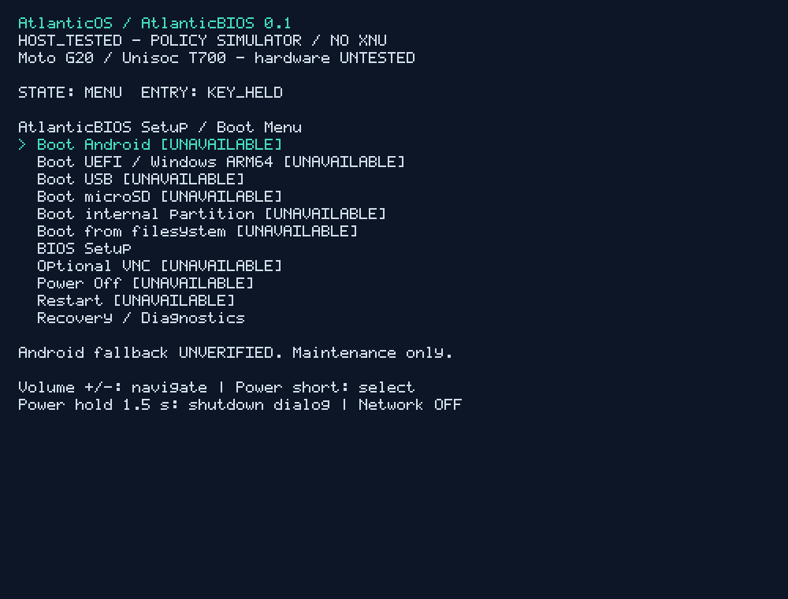

# AtlanticOS

Firmware de prearranque ARM64 propuesto, basado en un port auténtico y reducido
de XNU. Primera placa: Motorola Moto G20 / Unisoc T700 (UMS512).

**Estado 2026-10-21: auditoría Fase 0, prototipo host Fase 1 y port XNU
incremental. Cinco unidades reales de XNU compilan a objetos ARM64; todavía
no hay kernel enlazado, ejecución XNU ni drivers G20 funcionales. No hay firmware
AtlanticOS ejecutado en teléfono, ni medición de su RAM residente.**

Repositorio público: [h0nda1337/AtlanticOS](https://github.com/h0nda1337/AtlanticOS).
El trabajo local está en `G:\AtlanticOS`. El repositorio es independiente del
port UEFI G20. Ese proyecto tiene resultados físicos propios: no pertenecen a
AtlanticOS. Véanse [matriz de hechos](docs/FACT_MATRIX.md),
[estado de fases](docs/PHASE_STATUS.md) y [fuentes fijadas](docs/SOURCE_INDEX.md).
La [primera entrega verificada](docs/DELIVERY_REPORT.md) registra 46 tests locales,
reproducción en clon limpio y CI Ubuntu aprobada.
El [inventario propio del G20 del 2026-10-20](docs/DEVICE_INTAKE_20261020.md)
confirma identidad Android y desbloqueo por ADB, sin ejecutar firmware AtlanticOS.
La [meta activa](docs/ACTIVE_GOAL.md) prioriza XNU real y handoff EDK2; AtlanticBIOS
completo, VNC y Wi-Fi quedan para después. El [preflight ARM64](docs/ENTRY_LAB.md)
se ejecuta en QEMU desde EL1/EL2 y continúa en EL1h, con BSP propio, stack,
vectores y excepciones comprobados; sin XNU enlazado.

El [análisis offline del firmware](docs/STOCK_FIRMWARE_ANALYSIS.md) identifica
boot header v2, DTB y overlays de un paquete con fingerprint coincidente.
La variante de canal y las firmas OEM siguen pendientes; sus binarios permanecen privados.
La [receta MIG oficial](docs/MIG_HOST_BUILD.md) compila el generador de Apple y
produce interfaces ARM64 de XNU. El [build incremental](docs/XNU_LAB_BUILD.md)
compila bootstrap, scheduler, reloj, bootstrap VM y allocator kernel con un
perfil original. Las pruebas de thread.c y vm_map.c fallan y conservan sus
diagnósticos. Esos objetos no forman todavía un kernel ejecutable.

## Reproducir

Python 3.11 o superior, sin paquetes adicionales. Desde la raíz:

```powershell
python -m unittest discover -s tests -v
python tools/host-simulator/simulate.py --gui
python tools/host-simulator/simulate.py --gui --mock-android
python tools/validate.py
```

La GUI necesita Tk; `--console --no-framebuffer` ofrece fallback de consola.
Flechas = Volumen; Enter = Power; Power largo abre diálogo. El modo normal entra
en mantenimiento. La bandera `--mock-android` representa una ruta verificada
ficticia: nunca arranca un sistema real. Cuenta 5/4/3/2/1 con reloj monotónico.
Logs, capturas y hashes reproducibles se generan en `work/validation/`.

Clang es opcional: `python tools/build_abi.py` comprueba el contrato BSP como
objeto AArch64 independiente. **Ese objeto no es XNU, no enlaza un kernel y no
es una imagen arrancable.** `BUILT_ARM64` identifica compilación de un artefacto,
con el alcance declarado en cada manifiesto; nunca acredita ejecución.

`python tools/fetch_xnu.py` obtiene el upstream oficial fijado; queda ignorado
por Git. No se incluyen imágenes stock, claves, binarios UEFI ni wrappers.

## Documentación de ingeniería

- [Arquitectura](docs/ARCHITECTURE.md), [cadena de arranque](docs/BOOT_CHAIN.md),
  [contrato de entrada/handoff](docs/BOOT_CONTRACT.md).
- [Factibilidad XNU](docs/XNU_PORTING_FEASIBILITY.md) y
  [notas del patchset](xnu-port/PORTING_NOTES.md).
- [Fallback Android](docs/ANDROID_FALLBACK.md), [PMIC/energía](docs/POWER_AND_PMIC.md),
  [compatibilidad](docs/PLATFORM_MATRIX.md), [seguridad](docs/SECURITY_MODEL.md).
- [RAM y mediciones](docs/MEMORY_BUDGET.md), [validación](docs/VALIDATION.md),
  [pruebas del teléfono](docs/DEVICE_TEST_PLAN.md), [desconocidos](docs/RESEARCH_BACKLOG.md).

No BootShim ni ports preexistentes como sustitutos. La integración y los BSP se
desarrollan para AtlanticOS. El simulador no tiene acceso a particiones, ADB,
fastboot, USB físico, red ni funciones de apagado del PC. Nada se ha flasheado.
El acceso interno a bloques futuro será de solo lectura. Android debe conservar
recuperación independiente antes de habilitar AtlanticOS como predeterminado.

## Licencias y publicación

Código original: MIT, [LICENSE](LICENSE). XNU conserva APSL y los avisos por archivo;
consultar [procedencia](LICENSES-and-NOTICES/README.md). No se atribuye al proyecto
una licencia uniforme sobre fuentes externas. Las entregas se publican por commits
revisables en GitHub. Los artefactos de evidencia están en `evidence/host/` y
`evidence/arm64/`. Ningún commit equivale a una prueba del teléfono.


