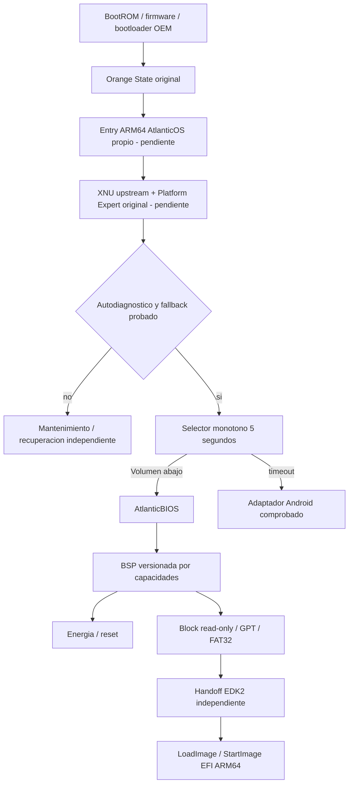

# Arquitectura AtlanticOS 0.1

Decisión: separar política de arranque, representación UI y capacidades BSP.
El modelo Python actual define comportamientos comprobables; no reemplaza el
futuro kernel. La implementación de firmware deberá portar esta política a C
y ejecutar dentro de un contexto XNU real, preservando los mismos escenarios.

| Capa | Responsabilidad | Implementación actual |
|---|---|---|
| atlantic-entry | capturar estado OEM, validar memoria, adaptador XNU | preflight propio QEMU EL1/EL2; adaptador XNU/G20 pendiente |
| xnu-upstream | fuente auténtica fijada, Mach/VM/scheduler | checkout oficial intacto; build en copia preparada |
| xnu-port | parches revisables, Platform Expert, build portable | catorce parches; 13 objetos estándar / 47 experimentales, sin enlace; Platform Expert pendiente |
| atlantic_core | máquina de estados/eventos/config/validación | Python host original |
| atlantic-core | implementación freestanding C de servicios comunes | parser FDT acotado; política C futura; Python no se enlaza a firmware |
| include/atlantic + platforms | ABI v1, capacidad y estado de evidencia | header y BSP G20 que devuelve UNSUPPORTED |
| ui | framebuffer textual mínimo y consola | render RGB original en host; GUI opcional |
| io | bloques/particiones/FAT32/USB/red | fixtures en memoria; drivers UNIMPLEMENTED |
| remote | RFB, auth, transporte protegido, consentimiento | UNIMPLEMENTED; gate de denegación host |
| handoff | transacción prepare/quiesce/commit | mock host; adaptadores reales UNIMPLEMENTED |

La BSP no exporta escritura de bloques ni set-active. Ninguna capacidad del
repositorio UEFI se hereda automáticamente. Para registrar DEVICE_VERIFIED se
requiere un registro AtlanticOS ligado al hash de su imagen y placa/firmware.

Un solo CPU en el primer bring-up. Primero logging y temporizador, después
interrupciones, pmap y bootstrap Mach. Los botones físicos no dependen de USB.
Si el framebuffer falla se mantiene consola; la salida física de esa consola
aún requiere identificar un canal viable. No asumir UART accesible al usuario.

El BSP consulta capacidades versionadas, no direcciones comunes a todos los SoC.
Los futuros Qualcomm/MediaTek implementarán la misma ABI con módulos separados.
Añadir otra carpeta no equivale a soportar otro teléfono.

El perfil de kernel conserva el subconjunto nativo BSD que XNU necesita para
metadata y vida útil conjunta de proc/task. Los tokens y backrefs permanecen en
la zona RO original; el ABI ARM64 se compara entre headers privados Mach y BSD.
MACH_BSD e IOKIT permanecen desactivados: no hay inicialización BSD ni userland.
Esto es integración compilada, todavía sin asignaciones o protección RO ejecutadas.
Véase [tareas y límites de la comprobación](XNU_TASK_LIFETIME.md).

En V1 XNU deja de ejecutarse al ceder a EDK2. Se cierran sesiones, se detiene DMA,
se invalidan callbacks y se transfiere propiedad de RAM. Los Runtime Services de
UEFI pertenecen al firmware destino. La residencia simultánea con Windows queda
fuera de V1; exigiría investigar virtualización y disponibilidad real de EL2.
