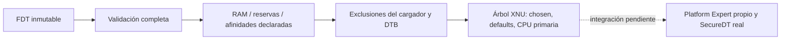

# Datos originales de arranque para XNU — 2026-10-23

AtlanticOS ahora puede inventariar un FDT validado y producir un árbol compacto
con el formato nativo esperado por XNU. El código está en atlantic-core/boot_tree.c,
se ejecuta en el preflight QEMU y conserva las exclusiones de memoria en una
estructura separada. **No construye boot_args ni inicia XNU.** SecureDT todavía
no ha consumido este resultado en una instancia de kernel.



## Contrato y límites

atl_fdt_walk valida toda la estructura antes de entregar eventos. Los nombres y
valores son spans prestados del blob; durante la visita no pueden modificarse.
El inventario recoge reg de nodos de memoria, memreserve, reserved-memory y
afinidades de CPU. No traslada automáticamente nodos de periféricos ni propiedades
de Android al árbol de XNU.

Los enteros FDT se leen explícitamente como big endian. Se requieren anchos de
celda explícitos de una o dos palabras (size-cells cero para CPU) y, en reserved-memory, el mismo esquema
que la raíz y ranges vacío. Un reg estático prevalece sobre size; una reserva
solo dinámica produce ATL_BOOT_DYNAMIC_RESERVATION. Esas reglas siguen la
[especificación de nodos y memoria](https://devicetree-specification.readthedocs.io/en/latest/chapter3-devicenodes.html)
y el [binding de reserved-memory](https://github.com/devicetree-org/dt-schema/blob/main/dtschema/schemas/reserved-memory/reserved-memory.yaml).

Los rangos se comprueban a 64 bits. Los solapamientos RAM son ambiguos y se
rechazan; las reservas solapadas o adyacentes se unen. Tanto no-map como reusable
permanecen excluidos en este bootstrap: no se implementa su reclamación. Se
mantienen también reservas fuera del RAM declarado, sin truncarlas a 32 bits.
El inventario admite 16 rangos RAM, 64 reservas y 32 CPU, con profundidad FDT
máxima de 32. Superar un límite falla; no descarta silenciosamente entradas.

El serializador acepta DRAM contigua; los huecos siguen en el inventario y
producen ATL_BOOT_NOT_CONTIGUOUS al pedir este árbol de bootstrap. Construye
/chosen con dram-base y dram-size de 64 bits, /defaults vacío y /cpus/cpu con
la afinidad de la CPU primaria y la frecuencia de contador observadas por el
entry. No inventa frecuencias de CPU, bus o memoria. La afinidad observada debe
existir una sola vez entre los CPU disponibles del FDT; AFF3 no representable
en el campo nativo de 32 bits se rechaza. La interpretación de reg se contrasta
con el [binding ARM de CPU](https://www.kernel.org/doc/Documentation/devicetree/bindings/arm/cpus.yaml).

El árbol de 504 bytes usa stores little endian y cabeceras nativas de nodo de
8 bytes y propiedad de 36. Los valores de DRAM quedan alineados a ocho bytes;
una propiedad vacía de padding conserva el stride nativo de cuatro bytes.
El layout se comprueba con los tipos reales de device_tree.h del XNU fijado,
sin duplicarlos. El consumidor de dram-base/size está en arm/arm_init.c y el de
reg/state en arm64/machine_routines.c. Este árbol anuncia solo el procesador
primario observado, sin afirmar que los demás estén apagados ni que SMP funcione.

La escritura se mide antes de tocar el destino. Buffers pequeños, parámetros
solapados, mapas inválidos o CPU desconocida no producen un árbol consumible.
No hay heap, MMIO ni IO de archivos dentro de la biblioteca. El harness de
inspección usa archivos regulares de host y nunca un dispositivo de bloques.

## Comprobaciones realizadas

- ASan/UBSan: esquemas de una y dos celdas, direcciones por encima de 4 GiB,
  unión de reservas, overflow, duplicados, reservas dinámicas, límites de tablas,
  aliases y CPU no disponible o sin representación nativa.
- Los 504 tamaños de destino insuficientes dejan el buffer intacto. Un lector
  independiente comprueba nombres, longitudes, counts, valores, padding y
  alineación de la salida. Se prueban 5.000 mutaciones FDT.
- El fixture de ABI compila con los carriles experimental y estándar contra
  headers XNU auténticos. Es compilación target, sin ejecución de SecureDT.
- El parser anterior conserva su regresión con 10.000 mutaciones y pasan las
  78 pruebas Python existentes.
- Cuatro ejecuciones QEMU: EL1 y EL2→EL1h, normal y BRK de diagnóstico. El entry
  original inventaría el árbol generado por QEMU, reserva su DTB y propia imagen,
  construye el árbol de 504 bytes y conserva las pruebas de stack/vector/contador.
  Todas imprimen XNU_NOT_LINKED; el BRK pertenece al entry original.

La imagen normal tiene 13.320 bytes de archivo y reserva 96.912 bytes de imagen,
BSS y stack según el linker. **Esto no mide el consumo de un firmware XNU ni
satisface el objetivo de menos de 100 MiB.** No hay discos o red en estos runs.
La [evidencia](../evidence/boot-data-bridge-20261023/manifest.json) conserva
comandos, hashes, mapas y logs; no contiene imágenes OEM.

## Contraste offline del candidato G20

El FDT base de 155.361 bytes del [paquete ya analizado](STOCK_FIRMWARE_ANALYSIS.md)
se procesa sin modificarlo. Declara un rango RAM [0x80000000, 0x100000000),
ocho afinidades 0x000/0x100/…/0x700 y seis rangos de reserva tras unir los
solapamientos/adyacencias. La reserva 0x100000000 de 0x1000 bytes se conserva
aunque quede fuera del RAM declarado. Son declaraciones del candidato offline,
no una medida de RAM, MPIDR o compatibilidad de este teléfono.

No se aplicaron overlays ni se obtuvo el árbol modificado por el bootloader.
No se usa el mapa offline para asignar RAM física. La frecuencia real y la
identidad del CPU primario siguen dependiendo de T05 en hardware.

## Pendiente antes de llamar a XNU

Faltan el Platform Expert original con PE_state y callbacks válidos, boot_args
completo, copia/propiedad del FDT, allocator que excluya todos los carveouts,
mapas y reservas de la imagen Mach-O, MMU/pmap y validación del consumidor real.
Añadir una exclusión declara propiedad; no autoriza a colocar una imagen sobre
un carveout existente. Esa comprobación debe ocurrir antes de cargar el payload,
y el mapeo de la apertura física también debe respetar las regiones no-map.
El árbol de bootstrap no proporciona por sí solo esos servicios ni bindings G20
de interrupciones, almacenamiento o energía. La recuperación independiente y la
vía temporal siguen siendo puertas físicas de DEVICE_TEST_PLAN.

El conjunto XNU sigue en 123 unidades experimentales; el último enlace de
149 objetos conserva 672 diagnósticos indefinidos y ninguna imagen. Esta entrega
avanza los datos del cargador, sin presentar su preflight como kernel XNU.

## Reproducir

```sh
python3 tools/test_boot_tree.py --sanitize --output work/boot-data-tests
python3 tools/test_boot_tree.py --sanitize --xnu-build <reporte-base> --output work/boot-data-native-abi
python3 tools/build_entry.py --output work/boot-data-entry
python3 tools/emulate_entry.py --build work/boot-data-entry
python3 tools/build_entry.py --probe el1-trap --output work/boot-data-trap
python3 tools/emulate_entry.py --build work/boot-data-trap
```

Usar Linux/WSL y carpetas nuevas. --dtb <archivo> añade una observación offline
al primer comando; un rechazo de schema se guarda como diagnóstico y no se
presenta como prueba aprobada. El DTB fuente permanece privado bajo work/.
