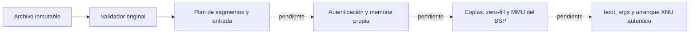

# Validación original de imagen estática ARM64 — 2026-10-25

`atlantic-core/macho.c` valida bytes Mach-O y entrega un plan acotado para el
perfil Atlantic LLD estático v2. No carga la imagen, no autentica su origen y no
inicia XNU. Este módulo portable no contiene MMIO ni dependencias G20; el BSP
de cada dispositivo tendrá que resolver asignación, ownership y traducciones.
Todavía no está integrado en el preflight QEMU ni en una imagen de kernel.



## Perfil aceptado

- Mach-O 64 bits little endian, ARM64 ALL, MH_EXECUTE y exclusivamente
  MH_NOUNDEFS. Se rechazan PAC/arm64e, PIE, otros flags y otras arquitecturas.
- Solo LC_SEGMENT_64, SYMTAB, DYSYMTAB, UNIXTHREAD y metadata opcional UUID y
  BUILD_VERSION. Los comandos de carga dinámica, fixups y cualquier comando
  desconocido fallan. La metadata de plataforma no concede servicios de macOS.
- Máximo 64 comandos / 32 KiB de comandos, 16 segmentos, 128 secciones y
  1 048 576 símbolos/entradas indirectas. Archivo y span virtual limitados a
  256 MiB. Estos son límites de entrada, **no RAM firmware medida**.
- Direcciones canónicas de 48 bits bajas o altas; base distinta de cero.
  Segmentos y offsets de archivo alineados a 16 KiB. El redondeo de cada
  mapping no puede desbordar ni solapar páginas del siguiente segmento.
- Primer segmento __TEXT RX con la cabecera completa; último __LINKEDIT R con
  tablas acotadas. Nombres únicos; permisos R, RW o RX, iguales a maxprot.
  Se admite SG_READ_ONLY únicamente sobre un segmento ya R. W+X falla.
- Secciones ordenadas, sin solapamientos ni relocaciones pendientes. Se aceptan
  datos regulares, zero-fill, literales y punteros no lazy ya enlazados. No se
  admiten TLS, stubs, constructores, destructores o atributos no soportados.
  Las secciones de instrucciones deben ser regulares y RX, con entrada de
  cuatro bytes completamente respaldada por el archivo.
- LC_UNIXTHREAD debe contener ARM_THREAD_STATE64 / 68 palabras: PC alineado y
  dentro de una sección de instrucciones. SP y todo el resto del estado deben
  ser cero. El bootstrap tiene que establecer su propio stack y estado de CPU.

MH_NOUNDEFS no basta por sí mismo: se recorre cada nlist, se rechazan undefineds,
imports weak y tipos indirectos/debug no soportados. Se permiten definiciones
N_SECT y N_ABS, incluyendo las weak ya resueltas por LLD. Las particiones de
DYSYMTAB cubren la tabla sin undefineds, tablas de bibliotecas o relocaciones
runtime. Las entradas indirectas deben ser índices válidos o marcas locales
estáticas. Se validan offsets de nombres y NUL final; no se vuelve a recorrer
una cadena potencialmente larga para cada símbolo.

## Contrato del plan

`include/atlantic/macho.h` expone base, span, PC y para cada segmento VA,
virtual_bytes, mapping_bytes, file_offset, file_bytes y protección. No devuelve
punteros prestados ni direcciones físicas. La entrada puede estar desalineada;
los enteros se decodifican byte a byte. No hay heap, libc, callbacks o MMIO.
Un fallo deja intactos entrada y salida; también se rechaza alias entre ambas.
El llamador debe proporcionar memoria legible/inmutable y salida escribible.

LLD puede colocar el inicio de una sección BSS dentro del relleno de una página
respaldada por archivo. El validador comprueba que esa intersección contiene
ceros. Así el plan puede describir una copia de file_bytes seguida de zero-fill
hasta mapping_bytes, sin conservar datos ajenos en BSS o en padding mapeado.
virtual_bytes y mapping_bytes se mantienen separados, incluido __LINKEDIT.

Un plan correcto no demuestra firma, identidad de placa, RAM real, permisos de
las tablas activas ni propiedad del destino. El futuro productor deberá:

1. Autenticar y retener exactamente los bytes inspeccionados; evitar cambios
   entre la validación y la copia. Un hash aislado no concede autorización.
2. Reservar páginas propias contra todo el inventario RAM/carveouts, imagen,
   árbol, stacks y contexto retenido. No derivar PA de VA con un cast ni cargar
   sobre reservas OEM. Resolver el contrato XNU virtBase/physBase explícitamente.
3. Copiar y poner a cero los spans validados; verificar readback, translations,
   permisos y barreras de caché antes de exponer el header al lector nativo XNU.
4. Construir boot_args y contexto retenido, implementar callbacks PE con pruebas
   reales de ownership/IRQ y entrar mediante la ABI propia instrumentada.

Todo ese productor sigue pendiente. Los lectores nativos de
[XNU_STRING_IMAGE_SUPPORT](XNU_STRING_IMAGE_SUPPORT.md) requieren una cabecera
real, validada, propia y mapeada; este nuevo parser cubre solamente la validación
de formato previa. No define un _mh_execute_header ficticio ni añade stubs al
enlace pendiente de 153 unidades base + 26 RPC / 476 indefinidos.

## Evidencia y reproducción

Las pruebas ejecutan exclusivamente el parser original en host con ASan/UBSan:
33 024 truncamientos con allocations de tamaño exacto, 12 000 mutaciones,
53 rechazos dirigidos, alias, entrada desalineada y direcciones bajas/altas.
Se comprueban canarios y ausencia de escrituras parciales en los fallos.

Además se leen las 15 salidas genuinas ya producidas por
[Atlantic LLD v2](LLD_STATIC_ARM64.md). Su procedencia se vincula al reporte y
hashes previos, y los planes se comparan con aquella inspección independiente.
Son programas pequeños de prueba, **no una imagen XNU**. El objeto ARM64 ELF del
parser no tiene imports; no se ejecuta. Las dos toolchains comparan constantes,
tamaños y offsets con los headers XNU fijados, sin modificarlos ni ejecutar XNU.

```sh
python3 tools/test_macho.py --sanitize --output work/macho-host-new
python3 tools/test_macho.py --sanitize --output work/macho-native-new \
  --lld-fixtures work/lld-static-weak-clean-tests-v2 \
  --xnu-build work/xnu-lab-builds/<build-id>/report.json
```

Se exige una carpeta de salida nueva. CI host ejecuta el contrato sintético;
las lanes XNU comprueban también ABI de los headers oficiales. Las 15 imágenes
LLD corresponden a la evidencia local; esos workflows no reconstruyen LLD.
Las pruebas físicas pendientes están en [DEVICE_TEST_PLAN](DEVICE_TEST_PLAN.md).

Formato contrastado con las fuentes oficiales fijadas:
[loader.h](https://github.com/apple-oss-distributions/xnu/blob/xnu-12377.1.9/EXTERNAL_HEADERS/mach-o/loader.h),
[nlist.h](https://github.com/apple-oss-distributions/xnu/blob/xnu-12377.1.9/EXTERNAL_HEADERS/mach-o/nlist.h)
y [estado ARM64](https://github.com/apple-oss-distributions/xnu/blob/xnu-12377.1.9/osfmk/mach/arm/_structs.h).
La implementación y harness son originales MIT; no se copia un cargador Apple,
BootShim o del port UEFI G20.
